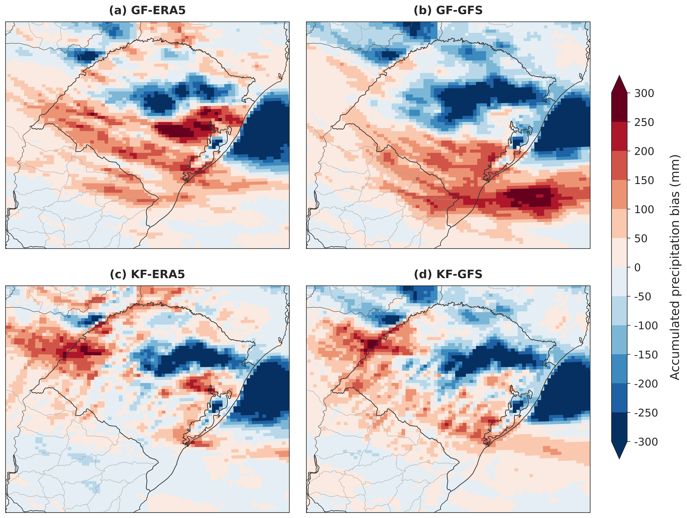
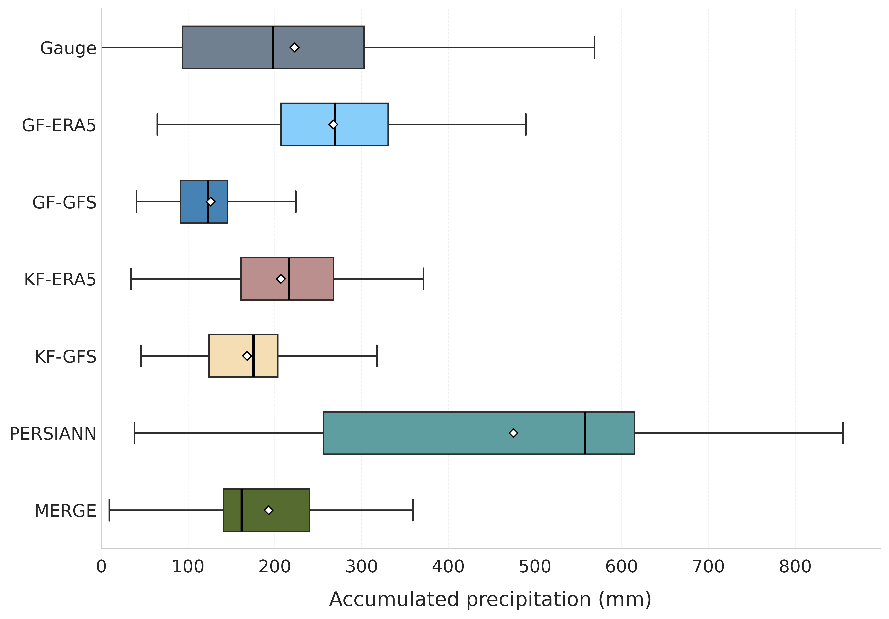
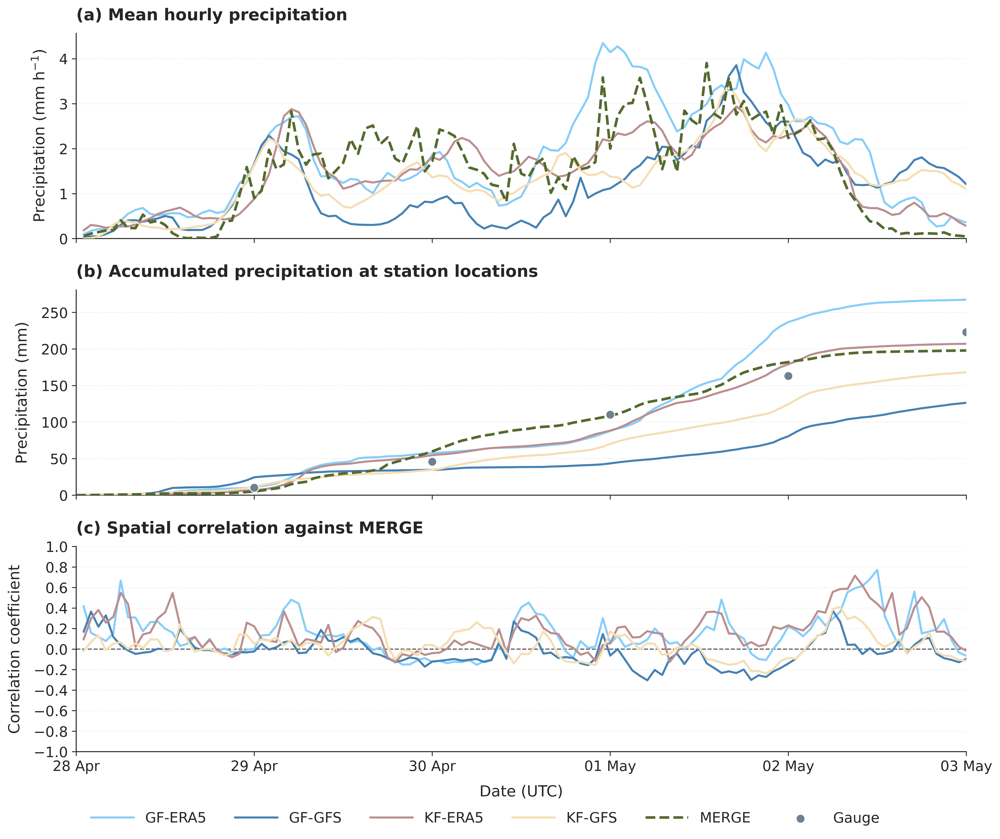
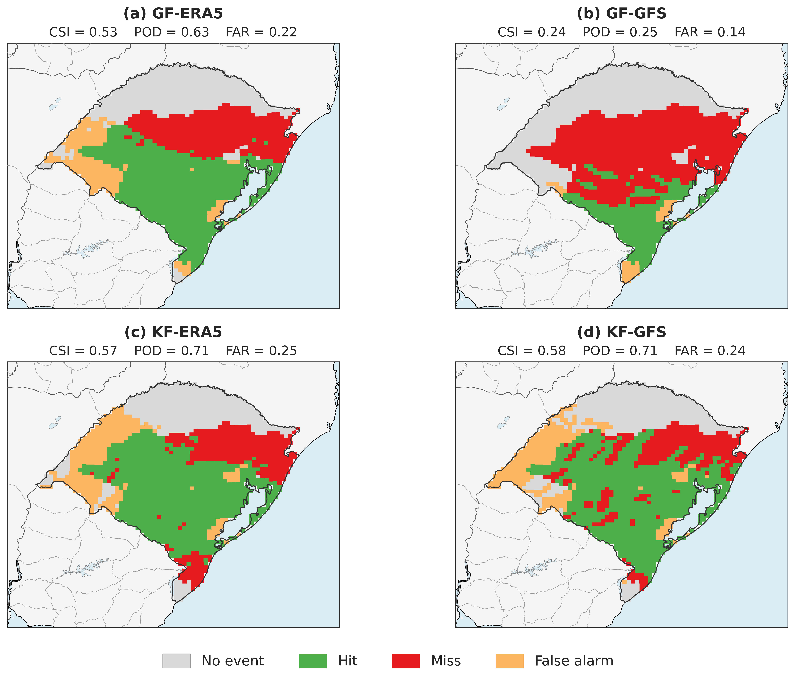
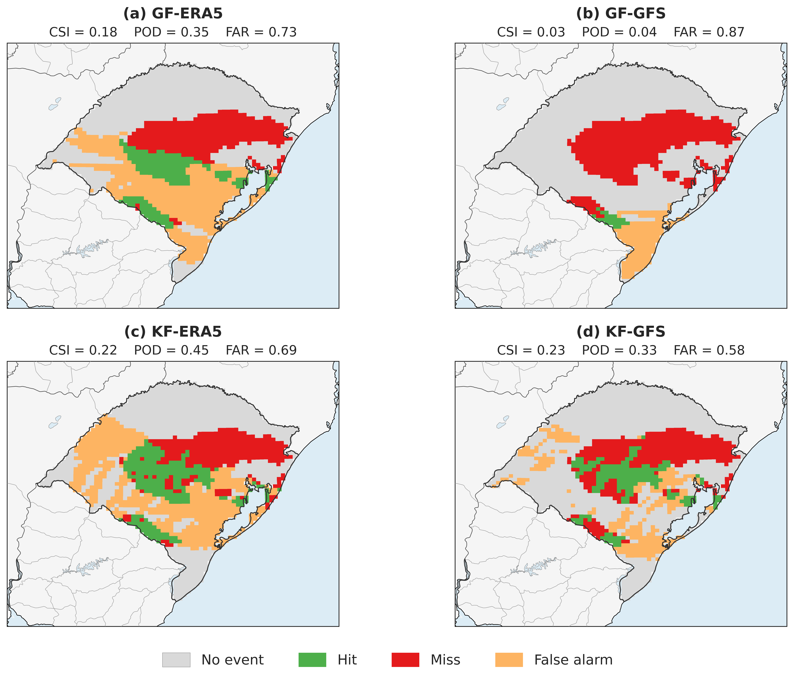
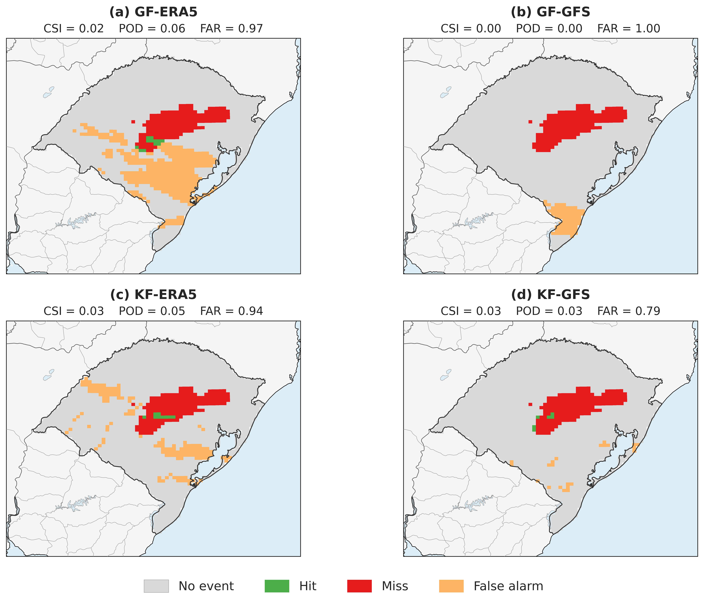
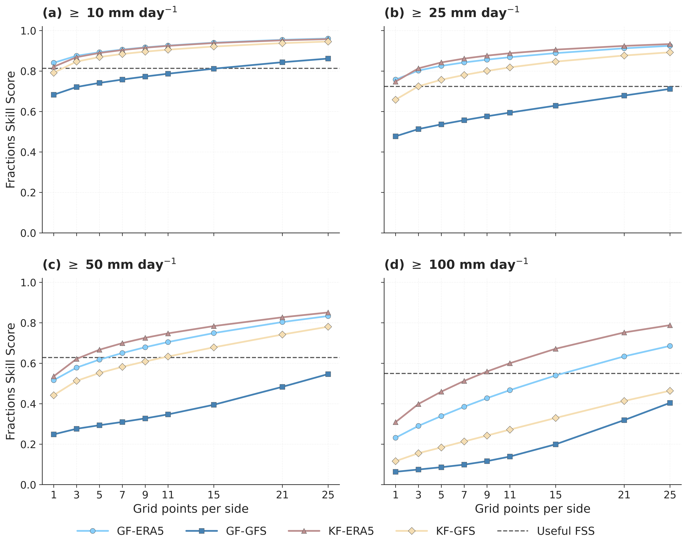

# WRF Precipitation Validation
[](https://doi.org/10.5281/zenodo.24540128)

### The April–May 2024 Extreme Rainfall Event in Southern Brazil


## Overview

This project investigates the sensitivity of precipitation
simulations performed with the Weather Research and Forecasting
(WRF) model during the extreme rainfall event that affected
Rio Grande do Sul, southern Brazil, between 28 April and
3 May 2024.

Four numerical experiments were conducted using different
atmospheric forcing datasets (ERA5 and GFS) and cumulus
parameterization schemes (Grell–Freitas and Kain–Fritsch).

Model performance is evaluated against gridded precipitation
products and meteorological station observations through spatial,
temporal, statistical, categorical, and scale-dependent
verification techniques.

---

## Contents

- [Scientific objectives](#scientific-objectives)
- [Study area](#study-area)
- [Experimental design](#experimental-design)
- [Validation datasets](#validation-datasets)
- [Verification methodology](#verification-methodology)
- [Results](#results)
- [Repository structure](#repository-structure)
- [Installation](#installation)
- [Data availability](#data-availability)
- [Academic context](#academic-context)

---

## Scientific objectives

- Assess the sensitivity of simulated precipitation to
  initial and lateral boundary conditions.
- Evaluate the influence of cumulus parameterization on
  precipitation magnitude and spatial distribution.
- Examine the ability of WRF to reproduce the temporal
  evolution of extreme precipitation.
- Quantify model performance against gridded precipitation
  products and meteorological station observations.
- Evaluate precipitation detection and spatial skill at
  different precipitation thresholds and spatial scales.

## Study area

The study focuses on Rio Grande do Sul, southern Brazil,
during the extreme precipitation event of late April and
early May 2024.

**Study period:** 28 April – 3 May 2024.

<p align="center">
  
</p>

<p align="center">
  <em>Figure 1. Geographical location and numerical
  simulation domain.</em>
</p>

## Experimental design

Four numerical experiments were conducted to investigate
the combined influence of atmospheric forcing and cumulus
parameterization on simulated precipitation.

| Experiment | Atmospheric forcing | Cumulus scheme |
|:---|:---:|:---|
| GF-ERA5 | ERA5 | Grell–Freitas |
| GF-GFS | GFS | Grell–Freitas |
| KF-ERA5 | ERA5 | Kain–Fritsch |
| KF-GFS | GFS | Kain–Fritsch |

## Validation datasets

| Dataset | Data type | Source |
|:---|:---|:---|
| MERGE | Gridded precipitation | CPTEC/INPE |
| PERSIANN | Gridded precipitation | CHRS |
| Station observations | Surface precipitation | 60 meteorological stations |

Gridded precipitation products and station observations
provide complementary information for evaluating the
spatial distribution, temporal evolution, and magnitude
of simulated precipitation.

## Verification methodology

The verification framework combines multiple approaches
to characterize model performance.

| Verification approach | Description |
|:---|:---|
| Spatial | Accumulated precipitation and spatial bias |
| Station-based | Statistical metrics at individual stations |
| Statistical | Precipitation distributions and daily agreement |
| Temporal | Hourly precipitation evolution |
| Categorical | Precipitation detection at different thresholds |
| Scale-dependent | Fractions Skill Score |

### Verification metrics

| Metric | Abbreviation |
|:---|:---:|
| Mean Bias | MB |
| Root Mean Square Error | RMSE |
| Pearson correlation coefficient | r |
| Probability of Detection | POD |
| False Alarm Ratio | FAR |
| Critical Success Index | CSI |
| Fractions Skill Score | FSS |

---

## Results

### 1. Spatial distribution of accumulated precipitation

The accumulated precipitation fields provide a comparison
of the spatial structure and magnitude of the event across
the four WRF experiments and the PERSIANN and MERGE
precipitation products.

<p align="center">
  
</p>

<p align="center">
  <em>Figure 2. Accumulated precipitation (mm) during
  the extreme rainfall event for the four WRF
  experiments, PERSIANN, and MERGE.</em>
</p>

### 2. Spatial precipitation bias

Spatial bias fields identify regions where the numerical
experiments overestimate or underestimate accumulated
precipitation relative to the reference dataset.

<p align="center">
  
</p>

<p align="center">
  <em>Figure 3. Spatial distribution of accumulated
  precipitation bias (mm) for the four WRF experiments.</em>
</p>

### 3. Station-based verification

Precipitation estimates from the four numerical experiments
and the two gridded precipitation products are evaluated
against meteorological station observations.

#### Mean Bias

<p align="center">
  
</p>

<p align="center">
  <em>Figure 4. Spatial distribution of precipitation
  bias at meteorological stations.</em>
</p>

#### Pearson correlation coefficient

<p align="center">
  
</p>

<p align="center">
  <em>Figure 5. Spatial distribution of the Pearson
  correlation coefficient between precipitation estimates
  and station observations.</em>
</p>

#### Root Mean Square Error

<p align="center">
  
</p>

<p align="center">
  <em>Figure 6. Spatial distribution of precipitation
  RMSE at meteorological stations.</em>
</p>

#### Probability of Detection

<p align="center">
  
</p>

<p align="center">
  <em>Figure 7. Spatial distribution of the Probability
  of Detection (POD) at meteorological stations.</em>
</p>

#### False Alarm Ratio

<p align="center">
  
</p>

<p align="center">
  <em>Figure 8. Spatial distribution of the False
  Alarm Ratio (FAR) at meteorological stations.</em>
</p>

### 4. Statistical comparison of precipitation

The statistical comparison examines differences in
precipitation distributions and the agreement between
precipitation estimates and observations.

#### Event precipitation distribution

<p align="center">
  
</p>

<p align="center">
  <em>Figure 9. Statistical distribution of precipitation
  accumulated during the event.</em>
</p>

#### Daily precipitation agreement

<p align="center">
  
</p>

<p align="center">
  <em>Figure 10. Density scatter plots comparing daily
  precipitation estimates with observations.</em>
</p>

### 5. Temporal evolution of precipitation

The temporal analysis evaluates the representation of
precipitation variability throughout the event.

<p align="center">
  
</p>

<p align="center">
  <em>Figure 11. Hourly evolution of precipitation
  during the extreme rainfall event.</em>
</p>

### 6. Categorical precipitation verification

Categorical verification evaluates the ability of the
numerical experiments to reproduce precipitation events
at different thresholds.

The analysis distinguishes four categories:

- **Hit:** precipitation event correctly detected.
- **Miss:** observed precipitation event not detected.
- **False alarm:** precipitation event predicted but not observed.
- **No event:** absence of precipitation event correctly identified.

#### Precipitation threshold: 20 mm

<p align="center">
  
</p>

<p align="center">
  <em>Figure 12. Spatial categorical verification
  for the 20 mm precipitation threshold.</em>
</p>

#### Precipitation threshold: 50 mm

<p align="center">
  
</p>

<p align="center">
  <em>Figure 13. Spatial categorical verification
  for the 50 mm precipitation threshold.</em>
</p>

#### Precipitation threshold: 100 mm

<p align="center">
  
</p>

<p align="center">
  <em>Figure 14. Spatial categorical verification
  for the 100 mm precipitation threshold.</em>
</p>

### 7. Scale-dependent precipitation verification

The Fractions Skill Score (FSS) evaluates the spatial
agreement between simulated and reference precipitation
fields at different neighbourhood sizes.

This approach accounts for spatial displacement errors
that may penalize high-resolution numerical simulations
when conventional grid-point verification methods are
applied.

<p align="center">
  
</p>

<p align="center">
  <em>Figure 15. Daily Fractions Skill Score for
  the four WRF experiments using MERGE as the
  reference precipitation dataset.</em>
</p>

---

## Computational workflow

The study was developed through the following
computational workflow:

1. Atmospheric forcing data acquisition.
2. WRF preprocessing and model configuration.
3. Numerical simulations.
4. Acquisition of reference precipitation datasets.
5. Spatial and temporal harmonization.
6. Station-based precipitation verification.
7. Statistical and categorical verification.
8. Scale-dependent verification.
9. Scientific visualization.

## Repository structure

```text
WRF-precipitation-validation-2024/
├── config/
├── data/
├── figures/
├── .gitignore
├── environment.yml
└── README.md
```

| Directory or file | Description |
|:---|:---|
| `config/` | Model configuration and processing resources |
| `data/` | Dataset documentation |
| `figures/` | Scientific figures and verification results |
| `environment.yml` | Python computational environment |
| `.gitignore` | Excluded datasets and temporary files |
| `README.md` | Project documentation |

## Installation

Clone the repository:

```bash
git clone https://github.com/fforgioni/WRF-precipitation-validation-2024.git
cd WRF-precipitation-validation-2024
```

Create the Conda environment:

```bash
conda env create -f environment.yml
```

Activate the environment:

```bash
conda activate wrf-validation
```

The Conda environment supports the Python-based
data processing and verification workflow.
WRF and WPS require separate installation.

## Data availability

The atmospheric forcing datasets and reference
precipitation products are provided by:

- **ERA5** — European Centre for Medium-Range
  Weather Forecasts (ECMWF).
- **GFS** — National Oceanic and Atmospheric
  Administration (NOAA).
- **MERGE** — Centro de Previsão de Tempo e Estudos
  Climáticos (CPTEC/INPE).
- **PERSIANN** — Center for Hydrometeorology and
  Remote Sensing (CHRS).

Due to the size of the atmospheric datasets and WRF
output files, these data may need to be obtained
separately.

Additional dataset information is available in
[data/README.md](data/README.md).

## Author

**Fernando Primo Forgioni**

[](https://orcid.org/0000-0003-3233-8957)
[](https://github.com/fforgioni)

## Academic context

This project was developed within the framework of
the Numerical Atmospheric Modelling course.

**Course:** Numerical Atmospheric Modelling  
**Professor** Dr. Guillermo Berri
**Faculty:** Facultad de Ciencias Astronómicas y Geofísicas (FCAG)  
**University:** Universidad Nacional de La Plata (UNLP)  
**Country:** Argentina

## Acknowledgements

The author acknowledge the institutions and research
centres responsible for providing the atmospheric
forcing datasets, precipitation products,
meteorological station observations, and numerical
modelling tools used in this study.

## Project status

The numerical experiments and precipitation
verification study have been completed.

---

<p align="center">
  <strong>Numerical Atmospheric Modelling</strong><br>
  Facultad de Ciencias Astronómicas y Geofísicas<br>
  Universidad Nacional de La Plata · Argentina · 2026
</p>

## License

The original source code developed for this project
is distributed under the MIT License.

See the [LICENSE](LICENSE) file for details.

Third-party datasets remain subject to the terms
and conditions established by their respective
providers.
